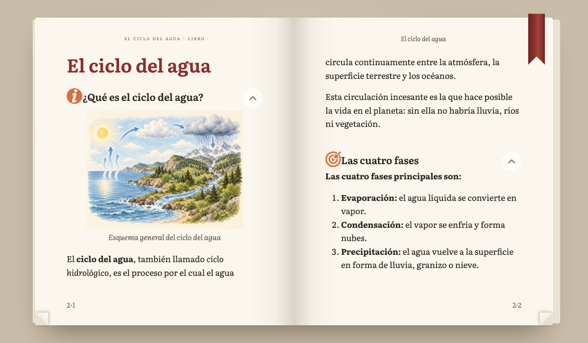

# eXeLearning Libro

[![eXeLearning 4.0.5+](https://img.shields.io/badge/eXeLearning-4.0.5%2B-26ddc7?labelColor=1f2937&logo=data%3Aimage%2Fsvg%2Bxml%3Bbase64%2CPHN2ZyB4bWxucz0iaHR0cDovL3d3dy53My5vcmcvMjAwMC9zdmciIHZpZXdCb3g9IjAgLTAuNTE5IDYwLjE3MTUyIDYwLjE3MTUyIj4gPGcgdHJhbnNmb3JtPSJ0cmFuc2xhdGUoLTEwOS44MDIwOCwtMTIxLjE3OTE3KSI%2BIDxwYXRoIGQ9Im0gMTIwLjYzOTEyLDEyMS4xNzkxNiBjIDIuNTAyOTYsMCA1LjE3Njg0LDAuOTEwMiA4LjAyMTExLDIuNzMwNiAyLjc4NzY1LDEuNzYzNSA2LjYyNzU1LDQuODkyMzMgMTEuNTE5Nyw5LjM4NjQ0IDguNDE5MywtNy4wNTQwNiAxMi45MTAzNCwtOC42NDMwMSAxNy4yMzM2MywtOC42NDMwMSAyLjc4NzY1LDAgNS4xNzY4NCwwLjc2Nzk4IDcuMTY3ODMsMi4zMDM5NCAzLjY2NzkyLDIuODA0NzcgNC4yNzk2Myw5LjIxMDIyIDEuNzEsMTMuNDIxNTcgLTIuMDQ3ODcsMy4zNTYzNyAtNC43MjE3NSw2Ljk2ODczIC04LjAyMTExLDEwLjgzNzAxIDcuNTA5MTQsOC41MzMwOCAxMS43MDMzMiwxNC42NzMgMTEuNzAzMzIsMTguODgyNzkgMCwzLjAxNDkyIC0wLjkzODc0LDUuMzE4OTIgLTIuODE1OTYsNi45MTE3MSAtMS45MzQxMSwxLjU5Mjc5IC00LjM1MTg3LDIuMzg5MTkgLTcuMjUzMDMsMi4zODkxOSAtNC4zODA0NCwwIC0xMS4yNDg0OSwtMy4zMjM3IC0xOS43MjQ2OCwtMTAuNDM0NjQgLTQuODM1MjYsNC4yNjY0IC04LjY0Njg1LDcuMjI0NzEgLTExLjQzNDI0LDguODc0MzkgLTIuODQ0NTMsMS42NDk2NyAtNS41NDY3MiwyLjQ3NDY1IC04LjEwNjU3LDIuNDc0NjUgLTMuNDEzMjMsMCAtNi4wNTg1LC0xLjEwOTQgLTcuOTM1NzgsLTMuMzI3OTMgLTEuOTM0MTgsLTIuMjc1NjggLTIuOTAxMjYsLTQuOTQ5MyAtMi45MDEyNiwtOC4wMjExMSAwLC0xLjk5MTI2IDAuMjg0NDMsLTMuNzI2MTMgMC44NTMzMSwtNS4yMDU0MSAwLjU2ODg4LC0xLjQ3OTAzIDEuNjIxMjksLTMuMTI4NyAzLjE1NzI1LC00Ljk0OTA0IDEuNTM1OTYsLTEuODc3NDggMy45ODIxMywtNC40NjU2MyA3LjMzODQ1LC03Ljc2NTI1IC0zLjI0MjU0LC0zLjI5OTM2IC01LjYzMTgxLC01Ljk0NDcxIC03LjE2NzgsLTcuOTM1NzYgLTEuNTkyODQsLTIuMDQ3OTUgLTIuNjczNjksLTMuODM5OTIgLTMuMjQyNTcsLTUuMzc1ODggLTAuNjI1NzcsLTEuNTM1OTYgLTAuOTM4NjQsLTMuMjQyNTcgLTAuOTM4NjQsLTUuMTE5ODcgMCwtMS45OTEwNyAwLjQyNjY0LC0zLjgzOTkgMS4yNzk5NSwtNS41NDY1MSAwLjg1MzM0LC0xLjc2MzUzIDIuMTA0ODQsLTMuMTg1NzIgMy43NTQ2LC00LjI2NjU4IDEuNjQ5NzMsLTEuMDgwODcgMy41ODM5MSwtMS42MjEzIDUuODAyNDksLTEuNjIxMyB6IiBmaWxsPSIjMjZkZGM3Ii8%2BIDwvZz4gPC9zdmc%2B)](https://exelearning.net)
[](https://github.com/ateeducacion/exelearning-style-book/raw/refs/heads/main/content/resources/book.zip)
[![Edit in eXeLearning](https://img.shields.io/badge/Edit%20in-eXeLearning-26ddc7?labelColor=1f2937&logo=data%3Aimage%2Fsvg%2Bxml%3Bbase64%2CPHN2ZyB4bWxucz0iaHR0cDovL3d3dy53My5vcmcvMjAwMC9zdmciIHZpZXdCb3g9IjAgLTAuNTE5IDYwLjE3MTUyIDYwLjE3MTUyIj4gPGcgdHJhbnNmb3JtPSJ0cmFuc2xhdGUoLTEwOS44MDIwOCwtMTIxLjE3OTE3KSI%2BIDxwYXRoIGQ9Im0gMTIwLjYzOTEyLDEyMS4xNzkxNiBjIDIuNTAyOTYsMCA1LjE3Njg0LDAuOTEwMiA4LjAyMTExLDIuNzMwNiAyLjc4NzY1LDEuNzYzNSA2LjYyNzU1LDQuODkyMzMgMTEuNTE5Nyw5LjM4NjQ0IDguNDE5MywtNy4wNTQwNiAxMi45MTAzNCwtOC42NDMwMSAxNy4yMzM2MywtOC42NDMwMSAyLjc4NzY1LDAgNS4xNzY4NCwwLjc2Nzk4IDcuMTY3ODMsMi4zMDM5NCAzLjY2NzkyLDIuODA0NzcgNC4yNzk2Myw5LjIxMDIyIDEuNzEsMTMuNDIxNTcgLTIuMDQ3ODcsMy4zNTYzNyAtNC43MjE3NSw2Ljk2ODczIC04LjAyMTExLDEwLjgzNzAxIDcuNTA5MTQsOC41MzMwOCAxMS43MDMzMiwxNC42NzMgMTEuNzAzMzIsMTguODgyNzkgMCwzLjAxNDkyIC0wLjkzODc0LDUuMzE4OTIgLTIuODE1OTYsNi45MTE3MSAtMS45MzQxMSwxLjU5Mjc5IC00LjM1MTg3LDIuMzg5MTkgLTcuMjUzMDMsMi4zODkxOSAtNC4zODA0NCwwIC0xMS4yNDg0OSwtMy4zMjM3IC0xOS43MjQ2OCwtMTAuNDM0NjQgLTQuODM1MjYsNC4yNjY0IC04LjY0Njg1LDcuMjI0NzEgLTExLjQzNDI0LDguODc0MzkgLTIuODQ0NTMsMS42NDk2NyAtNS41NDY3MiwyLjQ3NDY1IC04LjEwNjU3LDIuNDc0NjUgLTMuNDEzMjMsMCAtNi4wNTg1LC0xLjEwOTQgLTcuOTM1NzgsLTMuMzI3OTMgLTEuOTM0MTgsLTIuMjc1NjggLTIuOTAxMjYsLTQuOTQ5MyAtMi45MDEyNiwtOC4wMjExMSAwLC0xLjk5MTI2IDAuMjg0NDMsLTMuNzI2MTMgMC44NTMzMSwtNS4yMDU0MSAwLjU2ODg4LC0xLjQ3OTAzIDEuNjIxMjksLTMuMTI4NyAzLjE1NzI1LC00Ljk0OTA0IDEuNTM1OTYsLTEuODc3NDggMy45ODIxMywtNC40NjU2MyA3LjMzODQ1LC03Ljc2NTI1IC0zLjI0MjU0LC0zLjI5OTM2IC01LjYzMTgxLC01Ljk0NDcxIC03LjE2NzgsLTcuOTM1NzYgLTEuNTkyODQsLTIuMDQ3OTUgLTIuNjczNjksLTMuODM5OTIgLTMuMjQyNTcsLTUuMzc1ODggLTAuNjI1NzcsLTEuNTM1OTYgLTAuOTM4NjQsLTMuMjQyNTcgLTAuOTM4NjQsLTUuMTE5ODcgMCwtMS45OTEwNyAwLjQyNjY0LC0zLjgzOTkgMS4yNzk5NSwtNS41NDY1MSAwLjg1MzM0LC0xLjc2MzUzIDIuMTA0ODQsLTMuMTg1NzIgMy43NTQ2LC00LjI2NjU4IDEuNjQ5NzMsLTEuMDgwODcgMy41ODM5MSwtMS42MjEzIDUuODAyNDksLTEuNjIxMyB6IiBmaWxsPSIjMjZkZGM3Ii8%2BIDwvZz4gPC9zdmc%2B)](https://static.exelearning.dev/?url=https://github-proxy.exelearning.dev/?repo=ateeducacion/exelearning-style-book&branch=main)

Estilo de eXeLearning para leer un recurso como un libro abierto sobre la mesa.
Cada página del recurso se corta en páginas de libro: dos a la vez en pantallas
anchas y una en el móvil, sin desplazamiento vertical. El ejemplo incluye las 11
páginas de **El ciclo del agua**, con actividades de ordenar las fases y
verdadero/falso.




[Descargar estilo Libro](https://github.com/ateeducacion/exelearning-style-book/raw/refs/heads/main/content/resources/book.zip) · [Abrir el ejemplo en eXeLearning](https://static.exelearning.dev/?url=https://github-proxy.exelearning.dev/?repo=ateeducacion/exelearning-style-book&branch=main)

Importa `book.zip` desde el gestor de estilos de eXeLearning 4.
La raíz del repositorio es el ejemplo ELPX descomprimido; `theme/` contiene el estilo.
El botón «Edit with eXeLearning» es solo del ejemplo: está en `edit-in-exelearning.js`,
fuera del estilo, y no aparece en los recursos que se exporten con él.

## Lectura

- **Esquinas inferiores**: pasan página. Al pasar el ratón se levantan; al pulsar,
  la hoja se dobla desde la esquina, cruza el lomo y se posa al otro lado.
  En la última página de una sección se pasa a la siguiente; hacia atrás se abre
  la sección anterior por su última página.
- **Los tres bordes libres de cada hoja** (el exterior, el superior y el inferior):
  la hoja se puede coger por cualquier punto y se dobla desde ahí, con ratón, dedo
  o lápiz. El punto cogido sigue a la mano: se puede levantar un poco, detener,
  llevar en diagonal, cruzar el lomo, volver atrás y devolver a su sitio. Al soltar
  pasado el 30 % del recorrido la hoja termina de pasar; antes, vuelve. Un gesto
  rápido la pasa aunque se haya tirado poco, y uno rápido hacia atrás la devuelve.
  Escape la suelta. Junto al lomo no se puede coger: ahí está cosida.
  Las franjas ocupan solo los márgenes (32 px con ratón, 44 px con el dedo, nunca
  más que el margen), así que no tapan el contenido ni las actividades. Bajo el
  puntero el borde se levanta un poco, donde se cogería. Con una sola página, el
  borde superior y el inferior pasan hacia delante o hacia atrás según hacia dónde
  se tire.
- **← y →** (también Re Pág y Av Pág) pasan página fuera de los controles de las
  actividades. En el móvil también se puede deslizar el dedo.
- **Cinta de marcapáginas**: abre el índice, con el buscador y la licencia.
  Escape lo cierra.
- Los cantos de las hojas a los lados crecen o menguan según lo leído, y el pie
  de cada página lleva su número (sección·página).
- Una sección que acaba en la página izquierda cierra la derecha con un adorno y
  el enlace a la siguiente.

Las actividades nunca se parten entre páginas; si una no cabe en una página, se
desplaza dentro de ella. El paso de página usa transiciones de vista: en los
navegadores que no las tienen, o con «reducir movimiento», la página cambia sin
animación. Sin JavaScript, o al imprimir, el contenido se lee como una página normal.

## Cómo se dobla la hoja

El motor está en `theme/style.js`, sin dependencias, y separa cuatro cosas:

- **Geometría** (`foldTo`, `realFold`, `bound`, `creaseNormal`): funciones puras, sin DOM.
  La hoja se coge en `plan.grab`, un punto `{ x, y }` de un borde libre. El papel no
  se estira y está cosido al lomo: el punto cogido nunca se aleja de los dos extremos
  del lomo más de lo que lo está en reposo, y por eso el pliegue no corta la
  encuadernación. Lejos de una esquina, la inclinación del pliegue crece con lo que
  se ha tirado, para que no se doble de golpe una cuña entera de la hoja.
- **Gesto** (`hold`, `bindZone`): los eventos de puntero solo anotan dónde está la mano
  y su velocidad filtrada; no dibujan.
- **Dibujo y movimiento** (`stage`, `tick`, `glideTo`): un único bucle
  `requestAnimationFrame` dibuja como mucho una vez por fotograma, y nada si la hoja
  está quieta. Al soltar, la hoja sigue una curva de Hermite que parte de la posición
  y la velocidad de la mano y llega en reposo (120–500 ms según lo que falte;
  180–350 ms al volver; `--book-turn`, 0,7 s, para el giro automático).
- **Navegación** (`turnTo`, `openFold`, `openRoll`, `pageswap`/`pagereveal`).

Hay dos modelos con la misma geometría de pliegue:

- **Pliegue real** (tres imágenes). El pliegue es la mediatriz entre el punto cogido
  y la mano, y lo que queda detrás se refleja sobre la página. El reverso muestra la
  página real que lleva impresa (la enfrentada de la doble página siguiente), girada
  y sin texto invertido, y se posa exactamente sobre la página opuesta. Una transición
  de vista solo da dos imágenes de un elemento, así que se combinan dos: una del
  documento, que fotografía `main` durante un fotograma con las dos dobles páginas (el
  libro recorta la que sobra) y se queda con esa imagen fija para el reverso; y otra
  acotada al libro (`element.startViewTransition`), con la hoja y la página viva que
  descubre. Se usa a doble página en navegadores con transiciones acotadas (Chrome y
  Edge actuales).
- **Rollo** (dos imágenes). Donde no hay tercera imagen —una sola página, Firefox o
  Safari— el reverso es papel liso que se enrolla un poco por detrás de la mano y se
  estrecha hasta desaparecer al posarse.

**Entre secciones** cada sección es otro documento. Al posar el puntero en la esquina
o el borde que lleva a otra sección, o al coger la hoja, ese documento se carga en un
marco del tamaño de la ventana, que se maqueta igual que cuando se abra, y `main` lo
recorta a sus páginas. Así la hoja se dobla sobre la sección siguiente de verdad, y si
el marco ya estaba cargado al empezar a tirar, el reverso muestra también su página
real (pliegue real). Al soltar, la hoja se posa aquí y el cambio de documento ocurre
debajo, sin otra animación. Hacia atrás el marco abre la sección anterior por su
última página. Mientras el marco no ha cargado se ve papel en blanco, y si se suelta
antes, el documento siguiente termina el giro desde el punto en que se soltó, como
hasta ahora.

El marco es ese documento, no una copia: sus actividades se cargan (y sus scripts se
ejecutan) una vez en el marco y otra al abrirlo. Por eso solo se usa cuando el libro
se lee por su cuenta en http(s): no dentro de otra página (un LMS), ni abierto como
archivo (`file:`), ni con «reducir movimiento». Queda fuera del alcance del puntero,
del teclado y de los lectores de pantalla (`inert`, `aria-hidden`).

La luz acompaña al pliegue: una franja en coordenadas del pliegue hace de curva del
papel (más ancha cuanto más vertical es el pliegue y cuanto más se tira, nula en
reposo y al posarse), con su sombra sobre la página que descubre, y el reverso
proyecta una sombra que se abre con la altura. Nada se funde por opacidad.

No se clona ni se rasteriza ninguna actividad: todas las caras son capturas del
navegador de los nodos originales, que conservan su estado.

Medido en Chrome 157 sin interfaz (macOS, 1280×800, 1× y 2×): durante un arrastre
de 3 s el motor gasta unos 0,1 ms por fotograma en actualizar sus capas, con
intervalos de 16,7 ms (máximo 16,8), sin tareas largas; la hoja aparece unos 67 ms
después del primer movimiento, lo que tardan en estar listas las capturas. El motor
anterior daba las mismas cifras: lo que no convencía era la geometría y el
movimiento al soltar, no el rendimiento. El coste de composición en la GPU no se
puede medir sin interfaz.

## Vista previa y paquetes

```sh
python3 -m http.server 1314 --bind 127.0.0.1
python3 scripts/package.py
python3 scripts/check.py
```

Abre <http://localhost:1314/>. Los paquetes quedan en `dist/book.zip` y
`dist/ciclo-del-agua.elpx`; el ZIP del estilo también se copia a `content/resources/`
para descargarlo desde el ejemplo.

Las comprobaciones de navegador usan Chrome y el Playwright que ya incluye eXeLearning:

```sh
NODE_PATH=/ruta/a/exelearning/node_modules node scripts/check-browser.cjs
```

Recorren el libro entero con las esquinas, la vuelta a la última página de la
sección anterior, el teclado, el índice, las actividades, los anchos de móvil y
los arrastres: desde las esquinas y desde varios puntos de los tres bordes de
ambas hojas, con la hoja detenida a medio doblar, ida y vuelta sobre el lomo,
suelta fuera del libro, cambio de tamaño durante el gesto, paso entre una y dos
páginas, cincuenta giros seguidos, principio y final del libro, paso entre
secciones (con la sección siguiente o la anterior bajo la hoja) y arrastre táctil. `BOOK_CHROME` permite indicar la ruta de Chrome si
no está instalado en su ubicación habitual; `BOOK_BROWSER=firefox` (o `webkit`)
ejecuta lo mismo en los navegadores de Playwright, y `BOOK_VERBOSE=1` nombra cada
comprobación al llegar a ella.
`node scripts/check-turn.cjs` comprueba sin navegador la geometría (cualquier punto
de los bordes, ambos modelos, simetría, continuidad, valores finitos, unión al
lomo), la física al soltar y el ciclo de vida de un giro, incluida su limpieza.
Para regenerar la miniatura, añade `BOOK_SCREENSHOT=theme/screenshot.png` al comando.

## Mantenimiento y publicación

La estructura de publicación procede de `exelearning-style-pocket`: Actions,
`.gitignore`, `.gitattributes`, licencia y notas de `git archive`.

- `python3 scripts/build_water_cycle.py`: reconstruye el ejemplo ELPX y el estilo
  desde los archivos actuales.
- Para regenerar las páginas HTML del ejemplo, exporta el ELPX con el CLI de
  eXeLearning desde su propio directorio:
  `bun dist/cli.js elp:export /ruta/a/dist/ciclo-del-agua.elpx /tmp/libro html5`.
  Después, `python3 scripts/package.py` vuelve a añadir el botón del ejemplo.

El workflow **Release** se ejecuta manualmente desde Actions o al subir una etiqueta
`v*`. Comprueba el ejemplo y genera `exelearning-style-book-<versión>.zip`,
`book.zip` y `ciclo-del-agua.elpx`. En una ejecución manual se guardan como
artefactos; con una etiqueta se adjuntan a la release.

## Colección de estilos

Estilos de eXeLearning del Área de Tecnología Educativa. Cada repositorio incluye el estilo y un recurso de ejemplo que se puede abrir directamente en eXeLearning.

<table>
  <tr>
    <td align="center" width="33%"><a href="https://github.com/ateeducacion/exelearning-style-book"><br><b>Libro</b></a><br><sub>Libro abierto con paso de página</sub></td>
    <td align="center" width="33%"><a href="https://github.com/ateeducacion/exelearning-style-pocket"><br><b>Pocket</b></a><br><sub>Consola portátil de pantalla verde</sub></td>
    <td align="center" width="33%"><a href="https://github.com/ateeducacion/exelearning-style-hacker"><br><b>Hacker</b></a><br><sub>Terminal con Matrix, Tron y PipBoy</sub></td>
  </tr>
  <tr>
    <td align="center" width="33%"><a href="https://github.com/ateeducacion/exelearning-style-spectrum128k"><br><b>Spectrum 128K</b></a><br><sub>ZX Spectrum con franjas y CRT</sub></td>
    <td align="center" width="33%"><a href="https://github.com/ateeducacion/exelearning-style-scumm"><br><b>SCUMM Adventure</b></a><br><sub>Aventura gráfica con verbos e inventario</sub></td>
    <td align="center" width="33%"><a href="https://github.com/ateeducacion/exelearning-style-boost"><br><b>Boost</b></a><br><sub>Moodle Boost con índice del curso</sub></td>
  </tr>
  <tr>
    <td align="center" width="33%"><a href="https://github.com/ateeducacion/exelearning-style-teletext"><br><b>eXeTexto</b></a><br><sub>Teletexto con páginas numeradas</sub></td>
  </tr>
</table>

Los estilos oficiales para los centros educativos de Canarias (Flux, Nova y REF) están en [exelearning-styles-canarias](https://github.com/ateeducacion/exelearning-styles-canarias).

## Créditos y licencias

[Licencia general CC0](LICENSE), salvo los archivos que indican otra licencia.

El estilo deriva del estilo Default de eXeLearning (Ignacio Gros, exelearning.net)
y conserva su licencia CC BY-SA 4.0, igual que los iconos de iDevices de Francisco
Javier Pulido Cuadrado. Literata, de The Literata Project Authors, bajo
[SIL OFL 1.1](theme/fonts/OFL.txt). Recurso de ejemplo reutilizado
del estilo Spectrum 128K del Área de Tecnología Educativa del Gobierno de Canarias,
bajo CC0 1.0. Las 11 ilustraciones del ejemplo se han regenerado con la herramienta
ImageGen en acuarela y tinta; los prompts están en
[scripts/illustration-prompts.json](scripts/illustration-prompts.json).
Los archivos de eXeLearning y sus bibliotecas conservan sus licencias
originales.

El movimiento de la hoja toma [Turn.js](https://github.com/bahadirdogru/Turn.js-5)
como referencia visual. La geometría, las sombras y los gestos de este estilo son
una implementación independiente: no incluyen código ni dependencias de Turn.js.
Tampoco de StPageFlip, que se estudió como alternativa: necesita una página por
elemento y pliega desde las esquinas, y aquí las páginas son columnas CSS del
contenido original. Se conservan las columnas CSS y las capturas `book-page` /
`book-sheet-back`; no se clonan ni se reescriben iDevices.
